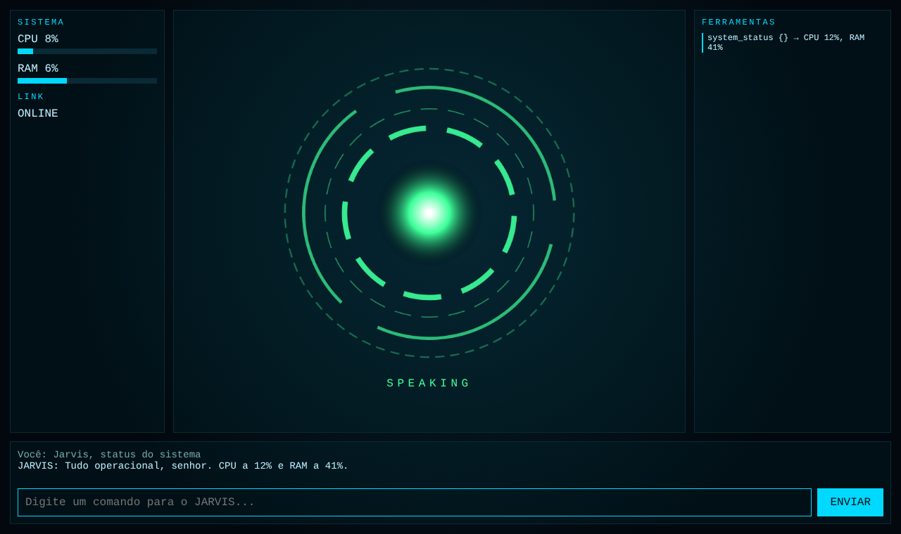

# JARVIS (híbrido)

Assistente pessoal: **voz local** (wake word + Whisper + TTS do Windows) e **cérebro na nuvem** (Claude, com tool-use).

## O que é / Objetivo
Assistente falado que responde, lembra de fatos, lê/grava arquivos num workspace, abre apps permitidos e consulta o estado do PC.

## Quando e como usar
Testar sem voz (qualquer SO):
```
pip install -r requirements.txt
copy .env.example .env      # preencha ANTHROPIC_API_KEY
python -m jarvis.main --text
```
Com voz (Windows, 16 GB RAM, sem GPU: Whisper `small` em CPU/int8):
```
pip install -r requirements-voice.txt
python -m jarvis.main
```
Interface visual (HUD) em qualquer modo: acrescente `--hud` (abre `http://127.0.0.1:8765/`).
```
python -m jarvis.main --text --hud
```


O HUD mostra o reator de arco (cor por estado: standby, listening, thinking, speaking), CPU/RAM, log de ferramentas e transcrição. Também aceita comandos digitados e exibe um modal para autorizar ou negar ações sensíveis.

Diga **"Hey Jarvis"**, aguarde "Pois não?" e fale o comando. Diga "encerrar" (modo texto: `sair`) para sair.

## Segurança (decisões de projeto)
- Arquivos: só dentro de `safety.workspace` (bloqueia `../`).
- Apps: só a allowlist do `config.yaml`; o comando nunca vem do modelo.
- `write_file`, `open_app` pedem confirmação (`safety.confirm_tools`).
- HUD: escuta só em `127.0.0.1`, token aleatório por sessão em todas as chamadas e checagem do cabeçalho `Host` (anti DNS rebinding). Saída do modelo é inserida com `textContent` (sem XSS).
- Chave de API só em `.env` (ignorado pelo git). Texto dos comandos vai à API Anthropic; áudio nunca sai do PC.

## Estado atual (honesto)
| Função | Status |
|---|---|
| Conversa, memória, arquivos, apps, status do PC, web fetch | Implementado e testado (`pytest tests`) |
| Voz (wake word, STT, TTS) | Implementado, **não testado em microfone real** (ambiente de build sem áudio/Windows) |
| E-mail, agenda, Drive | **Não implementado.** Próximo passo: ferramentas via Gmail/Calendar API ou MCP |
| Casa inteligente | **Não implementado.** Próximo passo: integrar Home Assistant |
| Visão de tela / controle de mouse | **Não implementado** (maior risco; fazer por último) |
| Interface HUD estilo Iron Man | Implementado e testado (`pytest`, renderização no Chromium sem erros de JS). Não verificado em Windows/Edge |

## Referências de design
[rezaulhreza/jarvis](https://github.com/rezaulhreza/jarvis), [llm-guy/jarvis](https://github.com/llm-guy/jarvis), [openWakeWord + Whisper](https://towardsdatascience.com/build-a-locally-running-voice-assistant-2f2ead904fe9/).
